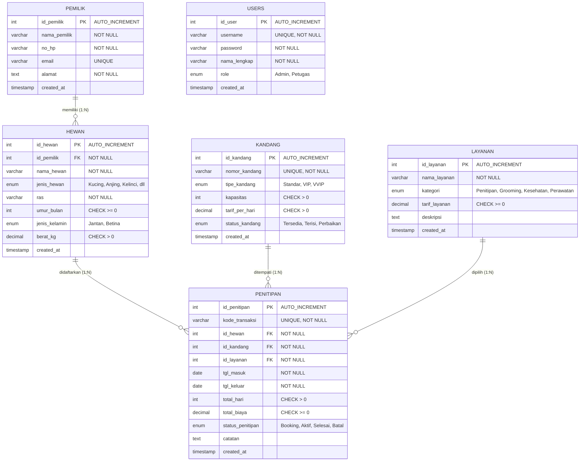

# PetShop
‣# Dokumentasi Tugas Besar Sistem Basis Data (SBD)
## Studi Kasus: Sistem Pet Shop & Penitipan Hewan Peliharaan

Website Sistem Informasi Pet Shop & Penitipan Hewan Peliharaan (**PetCare Studio**) dibangun menggunakan **PHP Native** (tanpa framework), **MySQL / phpMyAdmin**, dan antarmuka responsif modern menggunakan **HTML5, CSS3, dan Bootstrap 5**.

---

## 1. Entity Relationship Diagram (ERD)

Berikut adalah diagram relasi entitas (**ERD**) sistem yang menggambarkan relasi antar tabel (One-to-Many):



---

## 2. Struktur Skema Basis Data & Constraint

Sistem ini memiliki **5 Tabel Utama Berelasi + 1 Tabel User/Admin**:

| No | Nama Tabel | Deskripsi | Constraint Utama |
|---|---|---|---|
| 1 | `pemilik` | Master data pelanggan / pemilik hewan | `PRIMARY KEY`, `UNIQUE(email)`, `NOT NULL` |
| 2 | `hewan` | Data hewan peliharaan milik pelanggan | `PRIMARY KEY`, `FOREIGN KEY` ke `pemilik(id_pemilik)` [CASCADE], `CHECK(umur_bulan >= 0)`, `CHECK(berat_kg > 0)` |
| 3 | `kandang` | Fasilitas ruangan / kandang inap | `PRIMARY KEY`, `UNIQUE(nomor_kandang)`, `CHECK(kapasitas > 0)`, `CHECK(tarif_per_hari > 0)` |
| 4 | `layanan` | Paket layanan, grooming, medis | `PRIMARY KEY`, `CHECK(tarif_layanan >= 0)` |
| 5 | `penitipan` | Transaksi utama pemesanan inap | `PRIMARY KEY`, `UNIQUE(kode_transaksi)`, 3 `FOREIGN KEY` (Hewan, Kandang, Layanan) [RESTRICT], `CHECK(total_hari > 0)`, `CHECK(total_biaya >= 0)` |
| 6 | `users` | Akun autentikasi admin & petugas | `PRIMARY KEY`, `UNIQUE(username)` |

> Seluruh tabel telah diisi minimal **10 dummy data** realistis sesuai ketentuan tugas besar.

---

## 3. Implementasi Query JOIN (Sesuai Soal Poin 4)

Query multi-table JOIN di bawah ini menggabungkan 5 tabel sekaligus untuk menampilkan informasi transaksi secara komprehensif:

```sql
SELECT 
    p.kode_transaksi,
    pm.nama_pemilik,
    pm.no_hp,
    h.nama_hewan,
    h.jenis_hewan,
    h.ras,
    k.nomor_kandang,
    k.tipe_kandang,
    l.nama_layanan,
    p.tgl_masuk,
    p.tgl_keluar,
    p.total_hari,
    p.total_biaya,
    p.status_penitipan
FROM penitipan p
INNER JOIN hewan h ON p.id_hewan = h.id_hewan
INNER JOIN pemilik pm ON h.id_pemilik = pm.id_pemilik
INNER JOIN kandang k ON p.id_kandang = k.id_kandang
INNER JOIN layanan l ON p.id_layanan = l.id_layanan
ORDER BY p.id_penitipan DESC;
```

---

## 4. Fitur-Fitur Website

1. **Halaman Terpisah per Tabel (Ketentuan Soal No 2 & 3)**:
   - `/pemilik/` : CRUD Data Pemilik
   - `/hewan/` : CRUD Data Hewan Peliharaan
   - `/kandang/` : CRUD Fasilitas Ruang Kandang
   - `/layanan/` : CRUD Paket Layanan & Perawatan
   - `/penitipan/` : CRUD Transaksi Penitipan & Invoice
2. **Fitur Tambahan (Ketentuan Soal No 5)**:
   - **Pencarian Data (Search)**: Cari instan di setiap tabel.
   - **Filtering Data**: Filter berdasarkan jenis hewan, status kandang, kategori layanan, dan status penitipan.
   - **Sortir Data (Sorting)**: Pengurutan Ascending (A-Z) dan Descending (Z-A) berdasarkan berbagai kolom.
   - **Login & Logout Sederhana**: Proteksi sesi pengguna (`session_start()`).
   - **Kalkulator Biaya Otomatis**: Menghitung estimasi total tarif `(durasi × tarif kandang) + tarif layanan` secara real-time.
   - **Cetak Bukti Transaksi (Invoice Print)**: Fitur cetak nota penitipan siap print preview.
   - **Dashboard Statistik**: Counter ringkasan data, kandang tersedia, penitipan aktif, dan total omzet.

---

## 5. Cara Instalasi & Menjalankan

### Langkah 1: Persiapan Database
1. Buka **XAMPP** atau **Laragon**, lalu jalankan service **Apache** dan **MySQL**.
2. Buka browser dan akses **phpMyAdmin** (`http://localhost/phpmyadmin`).
3. Buat database baru bernama `petshop_db` (atau langsung import file SQL).
4. Klik tab **Import**, pilih file `database.sql` yang ada di direktori proyek ini, lalu klik **Go / Kirim**.

### Langkah 2: Menjalankan Website
- **Jika menggunakan XAMPP**: Letakkan folder `PetShop` ini di dalam `C:\xampp\htdocs\`.
  Akses di browser: `http://localhost/PetShop/`
- **Jika menggunakan Laragon**: Letakkan folder `PetShop` di dalam `C:\laragon\www\`.
  Akses di browser: `http://localhost/PetShop/` atau `http://PetShop.test/`
- **Atau menggunakan PHP CLI**:
  Jalankan terminal di folder proyek:
  ```bash
  php -S localhost:8000
  ```
  Lalu buka di browser: `http://localhost:8000`

---

## 6. Akun Login Demo Only

| Role | Username | Password |
|---|---|---|
| **Administrator** | `admin` | `admin123` |
| **Petugas / Staff** | `petugas` | `admin123` |

